# 行政區房市分析頁升級：完成報告

分支：`claude/dazzling-knuth-efebs5`（雲端 session 指定的工作分支，作用同任務書的 `cloud/district-upgrade`；沒有動 main）
範圍：WP1、WP2、WP3、WP4、WP7。WP5 北北桃擴充、WP6 排程自動化依任務書交由本機處理。

架構維持 **SQLite → 靜態 JSON → GitHub Pages**，沒有加任何後端或 Supabase。
資料口徑完全沒動：既有的 snapshots、projects、population、beido-market-data.json 一個位元組都沒改，新檔案全部由既有 JSON 衍生。

---

## 總覽

| WP | 狀態 | 主要產出 |
|---|---|---|
| WP1 自動市場總結 | ✅ | `assets/summary.js` 模板引擎、`data/summaries/*.json`（84 檔） |
| WP2 人口與所得 | ✅（所得、人口序列標「資料準備中」） | 人口分頁、人口×房價年增交叉表（行政區頁與全市都有） |
| WP3 行政區頁改版 | ✅ | 墨藍金＋Noto Serif TC 明體、依標竿重排模組、RWD |
| WP4 SEO／結構化資料 | ✅ | 13 區靜態頁 `district/<slug>/`、JSON-LD、sitemap、robots |
| WP7 預售建案清單 | ✅ | `data/presale_projects/*.json`、清單模組（同案異名合併） |

資料更新後一鍵重建全部衍生檔＋驗證：

```bash
node tools/build-all.mjs
```

建議本機 ETL（WP6 launchd）跑完後接這一行，摘要、預售清單、13 區頁面與 sitemap 都會跟著新資料更新。

---

## WP1 自動市場總結

**做法**：規則模板＋數據插值，不用 LLM。`assets/summary.js` 一份程式兩邊共用：瀏覽器用 `window.BeidoSummary`，Node 用 `require`。所以靜態 JSON 跟畫面上的文字是同一段程式產生的，逐字相同。

- 句型（依資料條件出現 5–8 句）：期間量與占全市比 → 單價中位數與 P25–P75 主力價位 → 與全市同期差距 → 總價中位數、半數成交區間、坪數中位數 → 產品結構（房型或建物型態前兩名）→ 單月年增（只在完整登錄月、樣本 ≥5 時判讀；登錄中的月份改寫「暫不判讀」）→ 樣本少於 30 筆時加「僅供參考」。
- 各分頁的一句話註解（`notes`）：行情總覽／成交趨勢／產品結構／預售建案／人口。
- 檔案：`data/summaries/<slug>_<resale|presale>_<12|24|36>.json`（13 區＋全市 `city`，共 84 檔，各市場的最新完整月），另有 `index.json` 索引。檔名用英文代稱（如 `zhongli`）以利網址。
- 前端選其他月份時，用同一個引擎即時產生摘要，所以每個月份都有。

**驗證**：`tools/check-summaries.mjs`
- 全部月份 × 14 個範圍（13 區＋全市）× 2 市場 × 3 期間，共 **14,784 組**模板輸出：0 筆含 NaN／undefined／null／待確認。
- 每段摘要裡的「筆數」「單價中位數」都和 snapshot 的期間值字串比對一致。
- 走勢圖的月序列加總等於 snapshot 的期間樣本數，也就是「月均件數」和圖表同源。
- 84 個靜態檔和即時計算逐字一致；瀏覽器實測畫面摘要＝`zhongli_presale_24.json` 的 `text`。

**順手修正的既有問題**：趨勢圖原本用陣列索引取「近 N 月」，序列缺月時會超出期間（2015 年前後最多多出好幾個月）。現在改用日曆月切片，圖、摘要、四格統計三者一致。

## WP2 人口與所得

- 「人口與所得」分頁：現住人口、戶數、戶量、里數 KPI（`data/population.json`，期別 2026-08）。
- `population.json` 只有單一期別，也查不到歷史版本，因此**戶籍人口趨勢折線、高齡人口比率、人口年增、所得（中位數／平均）**都標「資料準備中」，不虛構數字。Repo 內沒有所得資料。
- **人口年增 vs 房價年增交叉表**：放在行政區頁的人口分頁，全市頁也新增「05 人口×房價」分頁。
  - 房價年增＝近 12 月中位單價對比前一年同期近 12 月，兩期樣本都要 ≥5。
  - 附「每千人成交件數」＝近 12 月成交數 ÷ 人口 × 1000，衡量交易熱度。
  - 人口年增欄標「準備中」，補上逐月人口後就能直接對照。
  - 任一建物型態占比較去年位移超過 15 個百分點時，標「組成變動大」，提醒這個年增數字可能主要反映產品差異。例如大園區中古 −28.0%：華廈占比從 44% 升到 64%，資料本身正確，但屬於組成效果。

## WP3 行政區頁改版

模組順序對標行政區儀表板：

1. Hero（區名＋「房價行情」）＋三張 KPI 卡：中古屋均價、預售屋均價（單月中位＋月變化%）、現住人口。點卡片可切換市場。
2. 篩選列：行政區／市場（中古・預售）／期間（近 12・24・36 月）／指標（單價・總價）／分享。
3. 自動市場總結（問句標題＋模板段落）。
4. 四格統計：有效成交數／月均件數／單價中位／總價中位（期間值）。原有的單月 KPI 收進可展開的「單月數據」。
5. 逐筆成交（日期／社區／格局／樓層／單價／總價／坪數），手機版改卡片式。
6. 五分頁，各附一句註解：
   - 行情總覽：期間三值、P25/P50/P75 三欄、與全市同期比較橫條（期間＋單月）
   - 成交趨勢：雙軸圖，長條為成交量、折線為中位數；指標切到總價時折線改為總價
   - 產品結構：單價／總價／坪數 P25–P75 價位帶（本區 vs 全市）、建物型態或房型、樓層分布
   - 預售建案（見 WP7）
   - 人口與所得（見 WP2）
7. 本區建案索引（原有，保留）。
8. 桃園 13 區磁磚牆：單月中位價、樣本數、狀態標籤（本區／高於・低於全市 x%／樣本不足／本月無成交／登錄中）＋「地圖檢視」彈窗。

原有的資料與互動全部保留：全市頁四個分頁、建案專頁（預售簽約／交屋後實登互斥頁籤）、月份狀態標示、舊網址參數。

視覺：
- 沿用既有墨藍（#0c1a2b）＋金（#b7965b）與紙色底，標題改載入 Noto Serif TC 明體。
- 移除控制面板的大陰影、hero 光暈、卡片 hover 上浮與圓角，統一成直角細線。
- 進場動畫從 2.9 秒縮到約 1.7 秒，直接打開行政區頁時不播。
- 補上原本沒定義的 CSS 變數（`--paper-white`、`--gold-deep`、`--line-strong`）。原本這幾處背景是透明的，按鈕邊框也不見。

RWD：在 390／768／1280 寬度用無頭 Chromium 檢查，**整頁沒有橫向溢出**；預售清單表、逐筆表在手機和平板都不超出容器。

## WP4 SEO／結構化資料

- 每區一個靜態網址 `https://beedoo.com.tw/district/<slug>/`（例：`/district/zhongli/`），由 `tools/build-pages.mjs` 從 `index.html` 產生，有獨立的 title／description／canonical／OG。
- 前端切換行政區時網址同步改成該頁。舊的 `?district=中壢區` 連結會自動轉過去。
- JSON-LD（`@graph`）：
  - **Dataset**：name、description、temporalCoverage（`2010-10/2026-08`）、spatialCoverage（Place＋PostalAddress）、**isBasedOn＝內政部不動產交易實價查詢服務網（lvr.land.moi.gov.tw）**、creator／publisher、variableMeasured、measurementTechnique、distribution（指向 summaries JSON）。
  - **FAQPage**：每區最多 5 題（中古／預售房價多少、與全市比較、預售成交最多建案、人口）。答案就是自動摘要文字，並放在 `<noscript>` 內，讓頁面上看得到。
  - **BreadcrumbList**：桃園市房價行情 → ○○區房價行情。
- `sitemap.xml`（14 個網址）、`robots.txt`、`_config.yml`（Jekyll 排除 `tools/`、本報告、`report-assets/`、`project_aliases.json`）。

**驗證**：`tools/check-seo.mjs` 檢查 14 頁，0 錯誤。檢查內容：JSON 能解析、Google 文件列的必填／建議欄位、description 長度、canonical 與麵包屑末項相同、distribution 檔案存在、FAQ 問答在頁面上可見、sitemap 完整。關掉 JavaScript 載入 `/district/taoyuan/` 時 h1 和 FAQ 文字都在。

⚠️ 這個雲端環境的網路代理擋掉了 search.google.com 和 validator.schema.org，**沒辦法在線上跑 Google Rich Results 測試**。合併上線後，請拿 1–2 個區頁到 Rich Results Test 確認一次。另外提醒：Google 自 2023 年起只對政府、醫療類權威網站顯示 FAQ 複合式結果，FAQPage 標記仍然有效，但未必會出現摺疊問答樣式。Dataset 標記則會被 Google Dataset Search 收錄。

## WP7 預售建案清單

- `tools/build-presale-projects.mjs` 由 `data/projects/*.json` 產生 `data/presale_projects/<slug>.json`。只取有效簽約（已排除解約），無單價的簽約計件但不進中位數，和 snapshot 相同。
- **對帳**：任一月份、任一期間，清單成交量加總都等於 snapshot 的預售期間樣本數，中壢區近 12 月的 P25/P50/P75 也完全吻合。唯一例外是 2026-05～07 的「動態回補」月份：那批回補簽約還沒歸戶到建案檔，清單合計會略少。介面會直接顯示「清單合計 X 筆／期間預售成交 Y 筆」並說明原因。
- 欄位：建案名／期間成交量／最新成交日／中位單價。可依成交量、最新成交、中位單價排序，點建案進入建案專頁。
- **同案異名**：建案名沿用 `data/projects` 已套用的 `project_aliases`／`name_quality_report` 校正結果，再做顯示層合併（不改原始資料）：
  - R1 字形與空白正規化：悦／悅、鋭／銳、画／畫、双／雙、滙／匯、絵／繪、全半形、大小寫（例：`禾林 RICH ONE 3`＝`禾林RICH ONE3`、`牛津villa3／Villa3／VILLA3`）
  - R2 去「建設」字樣（`鼎巨建設La Vie No.5`＝`鼎巨La Vie No.5`）
  - R3 同一基底下 ≥3 個戶別代碼名視為同案（`合硯-光合硯A3-10` 等 97 個 → `合硯-光合硯`；`櫻花博A1-03` 等 184 個 → `櫻花博`）
  - R4 含「?」亂碼、且在同區只對應到唯一一個已校正名稱時併入（`中?ITC國際商貿中心` → `中悅ITC國際商貿中心`）
  - 共合併 21 組；合併紀錄在 `data/presale_projects/_merge_report.json`（Jekyll 不發布底線開頭的檔案）
- 無法唯一對應的 41 個亂碼名稱，「?」以「□」顯示並加「名稱校正中」標籤，不臆測字形。
- 自動檢查：13 區 × 3 期間 × 3 個時點，正規化後 0 筆重複名稱。

---

## 截圖（`report-assets/`）

| | |
|---|---|
|  行政區頁：KPI 卡＋篩選 |  自動摘要＋四格統計 |
|  行情總覽 |  成交趨勢 |
|  產品結構 |  預售建案 |
|  人口與所得＋交叉表 |  13 區磁磚牆 |
|  平板 768 |  手機 390 |
|  全市：人口×房價 | |

## 本機預覽

```bash
python3 -m http.server 8000
```

開 `http://localhost:8000/` 或 `http://localhost:8000/district/zhongli/`。

---

## 未竟事項／需要本機資料

1. **人口序列、高齡率、人口年增、所得**：需要本機補逐月戶籍人口（含年齡別）與綜稅所得。建議輸出成 `population.json` 的 `history`／`age65_ratio`／`income` 欄位，前端預留的「資料準備中」卡片就能換成真數字。
2. **級距分布（單價／總價／坪數各級距的筆數、占比、級距中位數）、中古屋齡與格局分布**：snapshots 只有 P25/50/75 與 type_mix／floor_mix，需要 ETL 在 snapshot 加 `price_bins`／`total_bins`／`ping_bins`／`age_mix`／`room_mix`。
3. **2026-05～07 動態回補簽約歸戶到建案**：歸戶後預售清單合計就會等於期間成交數。
4. **41 個亂碼建案名**：需要人工查建商官網或使用照，補進 `project_aliases.json`；`帝?德裝 德尊區` 很可能就是 `帝寶德莊 德尊區`（裝／莊字形差異），但規則不自動合併。
5. **Google Rich Results 線上測試**：雲端網路被擋，請上線後手動跑一次。
6. **WP5、WP6**：依任務書由本機處理；WP6 排程完成 ETL 後請接 `node tools/build-all.mjs`。
7. 其他觀察（未改動）：頁面右下角仍有「操作原型」標籤、footer 寫 OPERATION PROTOTYPE，正式上線前可考慮拿掉。`market.json` 的 resale_complete（2026-03）和前端實際使用的 `beido-market-data.json`（2026-04）不一致，前端只讀後者。

---

# 強化輪：QA／a11y／效能／自動化測試

本輪只動 `index.html`、`assets/`、`district/`、`data/summaries/`、`tools/`（外加 `report-assets/` 截圖與本報告）。**完全沒碰 `data/projects/` 與 `data/articles/`**（commit 已檢查），資料口徑不變。

## 一、全面 QA（`tools/qa/audit.cjs`）

範圍：14 頁（全市＋13 區）× 390／768／1280 × 每個分頁（行政區 5 個、全市 5 個），共 **210 次檢查**。

每次檢查的項目：console／page error、請求失敗與 4xx、整頁橫向溢出、元素超出視窗、文字被截斷、表格或圖表需要在容器內橫捲、摘要與四格統計數字等於 `data/summaries` 靜態 JSON、分頁註解沒有空句或 NaN、`aria-selected` 正確、網址維持 `/district/<slug>/`。

| | 首輪 | 修正後 |
|---|---|---|
| console error／page error／請求失敗 | 0 | 0 |
| 整頁橫向溢出 | 0 | 0 |
| 數字和靜態 JSON 不一致 | 0 | 0 |
| 表格或圖表需內部橫捲 | **42** | **0** |
| 腳本抓不到、要看截圖才發現的問題 | 9（見下表） | 0 |

找到並修掉的問題：

| # | 問題 | 修法 |
|---|---|---|
| 1 | 手機趨勢圖固定 640px，要在容器內橫捲 | 手機改用 380 寬的版本：少標月份、軸標題改放頂端；跨過斷點時自動重繪 |
| 2 | 手機的全市逐筆成交表被裁 | 手機改卡片式 |
| 3 | 手機和平板的人口×房價交叉表被裁 | 手機改卡片式，平板隱藏「戶數」欄 |
| 4 | `aria-live` 狀態區借用 skip-link 樣式，露在頁面中間 | 改用 `.sr-only` |
| 5 | 零樣本區（復興）四格顯示「占全市 —%」「坪數中位 — 坪」 | 改成「近 N 個月無成交」「樣本不足」 |
| 6 | 手機上第 5 個分頁籤（人口與所得）被捲出畫面，看不到 | 手機分頁籤改兩列 |
| 7 | 手機城市分頁第 5 格單獨一格，邊線不齊 | 第 5 格改跨兩欄 |
| 8 | 逐筆成交出現「22 房」「12 房」等登錄異常 | 超過 8 房顯示「格局待校正」（和建案頁同規則，原始資料不改） |
| 9 | 「操作原型」浮動標籤在手機上蓋住數據 | 手機版改放頁尾，不再浮動 |

修正前後對照（左＝修正前、右＝修正後）：

| 修正前 | 修正後 |
|---|---|
| 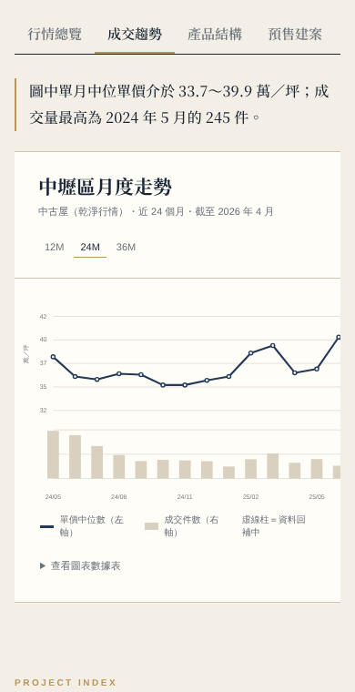 | 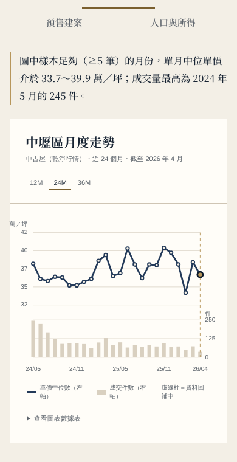 |
| 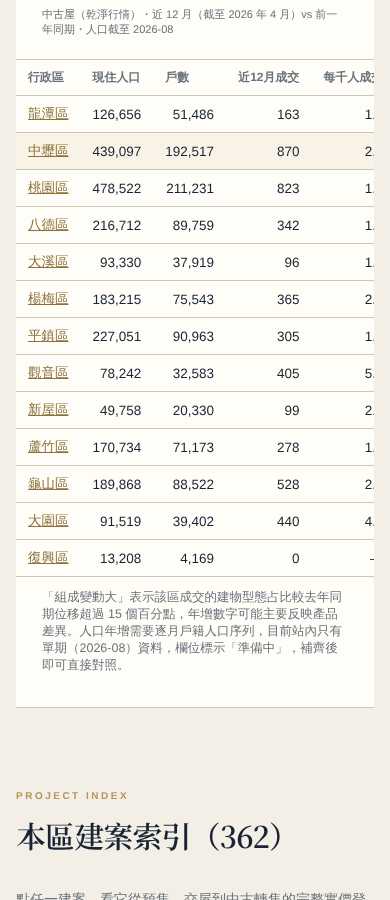 | 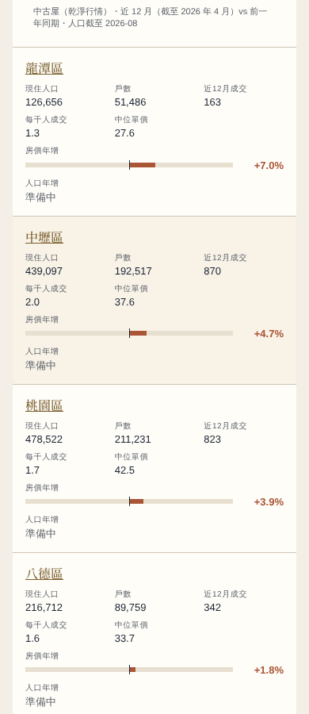 |
| 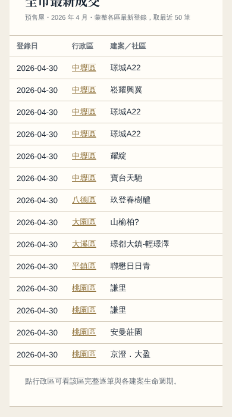 | 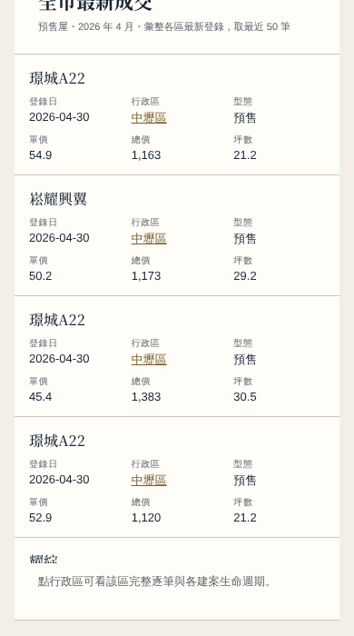 |
| 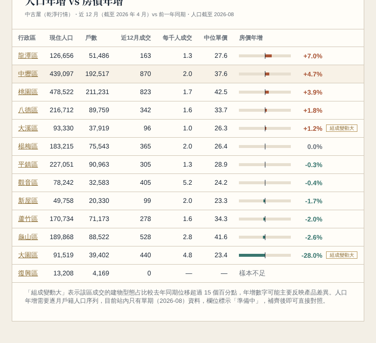 | 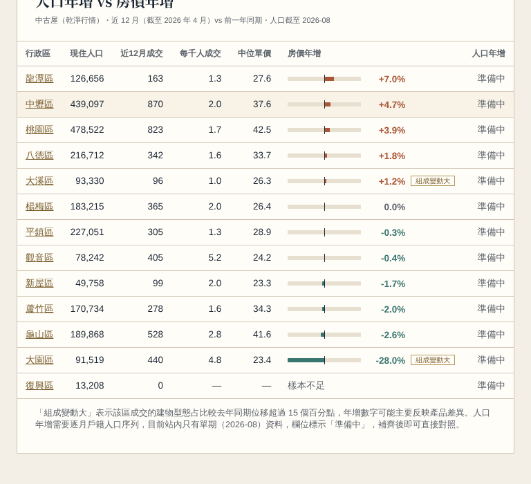 |
| 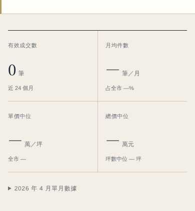 | 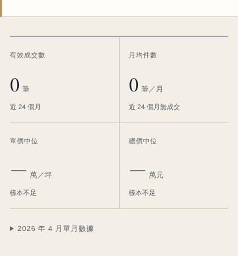 |
| 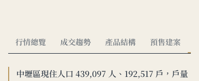 |  |

## 二、無障礙 a11y

- **鍵盤**：
  - 分頁籤用 roving tabindex：Tab 只停在選中的那一個，左右方向鍵、Home、End 切換，分頁內容區可以聚焦。
  - 地圖彈窗用原生 `<dialog>`：鍵盤開啟後焦點移到關閉鈕，Esc 關閉，焦點回到「地圖檢視」按鈕。
  - 焦點框改成深金 `#7a5f2e`（淺底）和淺金（深底），兩種底都 ≥3:1。
- **文字替代**：
  - 趨勢圖有 `<title>` 和 `<desc>`，內容是期間、最高與最低值、最新值，並說明完整數值見數據表；數據表加了 `<caption>`。
  - 每個 KPI 卡有完整的 `aria-label`。
  - 13 區磁磚的 `aria-label` 含中位價、件數與標籤，目前所在區標 `aria-current`。
  - 純裝飾的長條加 `aria-hidden`，旁邊已經有數字。
- **表格**：所有 `th` 都有 `scope`（col 或 row），分位表的列標題改用 `th scope="row"`。
- **色彩對比**（`tools/qa/contrast.mjs`，讀 `:root` 色票）：

| 色票 | 原值 → 新值 | 對比（底色） |
|---|---|---|
| 次要文字 `--muted` | #69717a（4.31，未達標）→ #5c636b | 5.30（紙色）／4.60（方法區） |
| 區塊小標、金色文字 | #b7965b（2.43，未達標）→ #7a5f2e | 5.22 |
| 圖表軸字 | #7a7d7f（4.08，未達標）→ #5c636b | 5.98 |
| 淺底上的狀態字 | #e2b96f（約 1.6，未達標）→ #8a5a12 | 5.15 |
| 深底註記 | #718292（4.43，未達標）→ #8a9aab | 6.08 |

  24 組前景×背景全部達 AA。亮金 #b7965b 只保留給裝飾線，選中狀態另外用文字色與粗細表示。成交量長條本身是淺色裝飾，數值有數據表作為替代。
- **prefers-reduced-motion**：不播進場動畫，平滑捲動改成瞬間跳轉，所有轉場時間趨近 0。

## 三、效能（`tools/qa/perf.cjs`，桌機、本機伺服器、未壓縮 body）

| 頁面 | 請求數 | 載入體積 | 首屏可見* |
|---|---|---|---|
| 全市首頁 | 9 → **7** | 675 KB → **498 KB**（−26%） | 919 → 298 ms |
| 中壢區（資料量最大的區） | 11 → **8** | 1,081 KB → **553 KB**（−49%） | 757 → 565 ms |
| 復興區 | 11 → 8 | 726 KB → 548 KB（−25%） | 561 → 519 ms |
| 中壢區・預售建案分頁 | 11 → 10 | 1,081 KB → 957 KB | 預售檔改成進這個分頁才載入 |

\* 本機伺服器的時間只能看相對差異；體積與請求數是準確的。上線後 GitHub Pages 會 gzip：`app.js` 23.5 KB、`beido-market-data.json` 30 KB、`presale_projects/zhongli.json` 90 KB。

做法：
- **延遲載入**：
  - 預售建案檔（中壢 351 KB）只在「預售建案」分頁才抓。
  - 建案索引 `projects/index.json`（155 KB）捲到「本區建案索引」才抓（IntersectionObserver）。
  - `redirect.json`（33 KB）只在網址帶 `project` 參數時才抓。
  - 去年同期快照只在「人口與所得」分頁才抓。
- 腳本加 `defer`；Google Fonts 改成不阻塞渲染（`media=print` → `all`，另有 noscript 後備）。
- 圖表只渲染目前的分頁；預售建案清單先顯示 30 列，「顯示更多」每次加 50 列；建案頁原本就分批載入。

## 四、自動化測試（`tools/qa/`，執行方式寫在 `tools/README.md`）

| 腳本 | 內容 | 結果 |
|---|---|---|
| `e2e.cjs` | 25 項：14 頁可開且無 console error、`/district/<slug>/` 網址與 h1、摘要等於靜態 JSON、四格數字、五分頁切換與網址參數、切區與上一頁、舊 `?district=` 轉址、方向鍵／Home／End、地圖彈窗焦點、圖表文字替代與 `th scope`、焦點樣式、reduced-motion、延遲載入、預售清單分批與排序、磁磚三態、無 JS 時的 h1／FAQ／JSON-LD | **25／25 通過** |
| `audit.cjs` | 上面的 210 次 QA | **0 issue** |
| `perf.cjs` | 請求數、體積、時間 | 見上表 |
| `contrast.mjs` | WCAG AA 對比 | **24／24** |
| `check-summaries.mjs`（加強） | 14,784 組摘要＋空句、重複、零漲幅措辭、全市比較方向矛盾 | **0 錯誤** |
| `check-seo.mjs` | 14 頁 JSON-LD | **0 錯誤** |

`node tools/build-all.mjs` 會重建所有衍生檔，並跑完所有不需要瀏覽器的檢查。

## 五、內容與模組完整度

- **13 區磁磚牆三態**：本區反白（深藍底＋`aria-current`＋「本區」標籤）、本月 0 筆顯示「本月無成交」、1–4 筆顯示「樣本不足」（原本寫「樣本偏少」，改成和任務書同名）。e2e 用 snapshot 逐區比對三態。
- **一句話註解**：行情總覽、成交趨勢、產品結構、預售建案、人口五個分頁都有，數字取自同一份 snapshot 或序列。e2e 和 audit 都檢查沒有空句與 NaN。
- **摘要引擎 v2**（`assets/summary.js`）新增的邊界句型：

| 情況 | 句型 |
|---|---|
| 0 筆 | 「沒有有效成交登錄」＋建議改近 36 月或切換市場 |
| 有筆數但沒有單價 | 「缺少可用單價」 |
| 1–4 筆 | 只報筆數與中位數，明說不計算主力價位、全市比較與漲跌 |
| P25＝P75 | 「中間一半成交都集中在這個價位」 |
| P75 為 P25 的 1.8 倍以上 | 「高低價差達 X 倍，區內產品差異明顯」 |
| 只有一種產品型態 | 「全部為 X」 |
| 單月樣本少於 5 筆 | 「單月僅 N 筆，暫不做單月漲跌判讀」 |
| 單月年增 ≥30% | 加註「單月波動大，宜以期間值為準」 |
| 期間內有缺月 | 趨勢註解加「期間內有 N 個月無成交登錄」；只有 1 個月樣本足夠時改用單點句型 |
| 措辭 | 「低出 X%」改成「比桃園市同期中位數 … 低 X%」 |

  全月份跑下來：610 組屬於 1–4 筆樣本、4,817 組屬於短摘要（多數是早年或小區的零樣本），都沒有空句或矛盾。

## 仍需本機補資料（雲端不編造數字）

1. **逐月戶籍人口、年齡別人口、綜稅所得**：人口趨勢折線、高齡率、人口年增、所得目前都標「資料準備中」，交叉表的人口年增欄標「準備中」。
2. **快照級距**：單價、總價、坪數各級距的筆數、占比與級距中位數，以及中古屋齡與格局分布，需要 ETL 在 snapshots 加上 `*_bins`、`age_mix`、`room_mix`。
3. **2026-05～07 預售動態回補簽約歸戶到建案**：歸戶後清單合計就會等於期間成交數，目前畫面會顯示差額與原因。
4. 41 個含亂碼的建案名需要人工校正，補進 `project_aliases.json`。
5. 上線後請到 Google Rich Results Test 手動跑 1–2 個區頁（雲端網路被擋）。

## 注意

`.gitignore` 預設忽略 `*.md`，本報告是用 `git add -f` 加入的。已在 `_config.yml` 排除，合併後不會被 Pages 公開；如果不想留在 repo，合併前刪掉即可。
