# 行政區房市分析頁升級：完成報告

分支：`claude/dazzling-knuth-efebs5`（雲端 session 指定的工作分支，作用同任務書的 `cloud/district-upgrade`；沒有動 main）
範圍：WP1、WP2、WP3、WP4、WP7。WP5 北北桃擴充、WP6 排程自動化依任務書交由本機處理。

架構維持 **SQLite → 靜態 JSON → GitHub Pages**，沒有加任何後端或 Supabase。
資料口徑完全沒動：既有的 snapshots、projects、population、beido-market-data.json 一個位元組都沒改，新檔案全部由既有 JSON 衍生。

---

## 總覽

| WP | 狀態 | 主要產出 |
|---|---|---|
| WP1 自動市場總結 | ✅ | `assets/summary.js` 模板引擎、`data/summaries/*.json`（84 檔） |
| WP2 人口與所得 | ✅（所得、人口序列標「資料準備中」） | 人口分頁、人口×房價年增交叉表（行政區頁與全市都有） |
| WP3 行政區頁改版 | ✅ | 墨藍金＋Noto Serif TC 明體、依標竿重排模組、RWD |
| WP4 SEO／結構化資料 | ✅ | 13 區靜態頁 `district/<slug>/`、JSON-LD、sitemap、robots |
| WP7 預售建案清單 | ✅ | `data/presale_projects/*.json`、清單模組（同案異名合併） |

資料更新後一鍵重建全部衍生檔＋驗證：

```bash
node tools/build-all.mjs
```

建議本機 ETL（WP6 launchd）跑完後接這一行，摘要、預售清單、13 區頁面與 sitemap 都會跟著新資料更新。

---

## WP1 自動市場總結

**做法**：規則模板＋數據插值，不用 LLM。`assets/summary.js` 一份程式兩邊共用：瀏覽器用 `window.BeidoSummary`，Node 用 `require`。所以靜態 JSON 跟畫面上的文字是同一段程式產生的，逐字相同。

- 句型（依資料條件出現 5–8 句）：期間量與占全市比 → 單價中位數與 P25–P75 主力價位 → 與全市同期差距 → 總價中位數、半數成交區間、坪數中位數 → 產品結構（房型或建物型態前兩名）→ 單月年增（只在完整登錄月、樣本 ≥5 時判讀；登錄中的月份改寫「暫不判讀」）→ 樣本少於 30 筆時加「僅供參考」。
- 各分頁的一句話註解（`notes`）：行情總覽／成交趨勢／產品結構／預售建案／人口。
- 檔案：`data/summaries/<slug>_<resale|presale>_<12|24|36>.json`（13 區＋全市 `city`，共 84 檔，各市場的最新完整月），另有 `index.json` 索引。檔名用英文代稱（如 `zhongli`）以利網址。
- 前端選其他月份時，用同一個引擎即時產生摘要，所以每個月份都有。

**驗證**：`tools/check-summaries.mjs`
- 全部月份 × 14 個範圍（13 區＋全市）× 2 市場 × 3 期間，共 **14,784 組**模板輸出：0 筆含 NaN／undefined／null／待確認。
- 每段摘要裡的「筆數」「單價中位數」都和 snapshot 的期間值字串比對一致。
- 走勢圖的月序列加總等於 snapshot 的期間樣本數，也就是「月均件數」和圖表同源。
- 84 個靜態檔和即時計算逐字一致；瀏覽器實測畫面摘要＝`zhongli_presale_24.json` 的 `text`。

**順手修正的既有問題**：趨勢圖原本用陣列索引取「近 N 月」，序列缺月時會超出期間（2015 年前後最多多出好幾個月）。現在改用日曆月切片，圖、摘要、四格統計三者一致。

## WP2 人口與所得

- 「人口與所得」分頁：現住人口、戶數、戶量、里數 KPI（`data/population.json`，期別 2026-08）。
- `population.json` 只有單一期別，也查不到歷史版本，因此**戶籍人口趨勢折線、高齡人口比率、人口年增、所得（中位數／平均）**都標「資料準備中」，不虛構數字。Repo 內沒有所得資料。
- **人口年增 vs 房價年增交叉表**：放在行政區頁的人口分頁，全市頁也新增「05 人口×房價」分頁。
  - 房價年增＝近 12 月中位單價對比前一年同期近 12 月，兩期樣本都要 ≥5。
  - 附「每千人成交件數」＝近 12 月成交數 ÷ 人口 × 1000，衡量交易熱度。
  - 人口年增欄標「準備中」，補上逐月人口後就能直接對照。
  - 任一建物型態占比較去年位移超過 15 個百分點時，標「組成變動大」，提醒這個年增數字可能主要反映產品差異。例如大園區中古 −28.0%：華廈占比從 44% 升到 64%，資料本身正確，但屬於組成效果。

## WP3 行政區頁改版

模組順序對標行政區儀表板：

1. Hero（區名＋「房價行情」）＋三張 KPI 卡：中古屋均價、預售屋均價（單月中位＋月變化%）、現住人口。點卡片可切換市場。
2. 篩選列：行政區／市場（中古・預售）／期間（近 12・24・36 月）／指標（單價・總價）／分享。
3. 自動市場總結（問句標題＋模板段落）。
4. 四格統計：有效成交數／月均件數／單價中位／總價中位（期間值）。原有的單月 KPI 收進可展開的「單月數據」。
5. 逐筆成交（日期／社區／格局／樓層／單價／總價／坪數），手機版改卡片式。
6. 五分頁，各附一句註解：
   - 行情總覽：期間三值、P25/P50/P75 三欄、與全市同期比較橫條（期間＋單月）
   - 成交趨勢：雙軸圖，長條為成交量、折線為中位數；指標切到總價時折線改為總價
   - 產品結構：單價／總價／坪數 P25–P75 價位帶（本區 vs 全市）、建物型態或房型、樓層分布
   - 預售建案（見 WP7）
   - 人口與所得（見 WP2）
7. 本區建案索引（原有，保留）。
8. 桃園 13 區磁磚牆：單月中位價、樣本數、狀態標籤（本區／高於・低於全市 x%／樣本偏少／本月無成交／登錄中）＋「地圖檢視」彈窗。

原有的資料與互動全部保留：全市頁四個分頁、建案專頁（預售簽約／交屋後實登互斥頁籤）、月份狀態標示、舊網址參數。

視覺：
- 沿用既有墨藍（#0c1a2b）＋金（#b7965b）與紙色底，標題改載入 Noto Serif TC 明體。
- 移除控制面板的大陰影、hero 光暈、卡片 hover 上浮與圓角，統一成直角細線。
- 進場動畫從 2.9 秒縮到約 1.7 秒，直接打開行政區頁時不播。
- 補上原本沒定義的 CSS 變數（`--paper-white`、`--gold-deep`、`--line-strong`）。原本這幾處背景是透明的，按鈕邊框也不見。

RWD：在 390／768／1280 寬度用無頭 Chromium 檢查，**整頁沒有橫向溢出**；預售清單表、逐筆表在手機和平板都不超出容器。

## WP4 SEO／結構化資料

- 每區一個靜態網址 `https://beedoo.com.tw/district/<slug>/`（例：`/district/zhongli/`），由 `tools/build-pages.mjs` 從 `index.html` 產生，有獨立的 title／description／canonical／OG。
- 前端切換行政區時網址同步改成該頁。舊的 `?district=中壢區` 連結會自動轉過去。
- JSON-LD（`@graph`）：
  - **Dataset**：name、description、temporalCoverage（`2010-10/2026-08`）、spatialCoverage（Place＋PostalAddress）、**isBasedOn＝內政部不動產交易實價查詢服務網（lvr.land.moi.gov.tw）**、creator／publisher、variableMeasured、measurementTechnique、distribution（指向 summaries JSON）。
  - **FAQPage**：每區最多 5 題（中古／預售房價多少、與全市比較、預售成交最多建案、人口）。答案就是自動摘要文字，並放在 `<noscript>` 內，讓頁面上看得到。
  - **BreadcrumbList**：桃園市房價行情 → ○○區房價行情。
- `sitemap.xml`（14 個網址）、`robots.txt`、`_config.yml`（Jekyll 排除 `tools/`、本報告、`report-assets/`、`project_aliases.json`）。

**驗證**：`tools/check-seo.mjs` 檢查 14 頁，0 錯誤。檢查內容：JSON 能解析、Google 文件列的必填／建議欄位、description 長度、canonical 與麵包屑末項相同、distribution 檔案存在、FAQ 問答在頁面上可見、sitemap 完整。關掉 JavaScript 載入 `/district/taoyuan/` 時 h1 和 FAQ 文字都在。

⚠️ 這個雲端環境的網路代理擋掉了 search.google.com 和 validator.schema.org，**沒辦法在線上跑 Google Rich Results 測試**。合併上線後，請拿 1–2 個區頁到 Rich Results Test 確認一次。另外提醒：Google 自 2023 年起只對政府、醫療類權威網站顯示 FAQ 複合式結果，FAQPage 標記仍然有效，但未必會出現摺疊問答樣式。Dataset 標記則會被 Google Dataset Search 收錄。

## WP7 預售建案清單

- `tools/build-presale-projects.mjs` 由 `data/projects/*.json` 產生 `data/presale_projects/<slug>.json`。只取有效簽約（已排除解約），無單價的簽約計件但不進中位數，和 snapshot 相同。
- **對帳**：任一月份、任一期間，清單成交量加總都等於 snapshot 的預售期間樣本數，中壢區近 12 月的 P25/P50/P75 也完全吻合。唯一例外是 2026-05～07 的「動態回補」月份：那批回補簽約還沒歸戶到建案檔，清單合計會略少。介面會直接顯示「清單合計 X 筆／期間預售成交 Y 筆」並說明原因。
- 欄位：建案名／期間成交量／最新成交日／中位單價。可依成交量、最新成交、中位單價排序，點建案進入建案專頁。
- **同案異名**：建案名沿用 `data/projects` 已套用的 `project_aliases`／`name_quality_report` 校正結果，再做顯示層合併（不改原始資料）：
  - R1 字形與空白正規化：悦／悅、鋭／銳、画／畫、双／雙、滙／匯、絵／繪、全半形、大小寫（例：`禾林 RICH ONE 3`＝`禾林RICH ONE3`、`牛津villa3／Villa3／VILLA3`）
  - R2 去「建設」字樣（`鼎巨建設La Vie No.5`＝`鼎巨La Vie No.5`）
  - R3 同一基底下 ≥3 個戶別代碼名視為同案（`合硯-光合硯A3-10` 等 97 個 → `合硯-光合硯`；`櫻花博A1-03` 等 184 個 → `櫻花博`）
  - R4 含「?」亂碼、且在同區只對應到唯一一個已校正名稱時併入（`中?ITC國際商貿中心` → `中悅ITC國際商貿中心`）
  - 共合併 21 組；合併紀錄在 `data/presale_projects/_merge_report.json`（Jekyll 不發布底線開頭的檔案）
- 無法唯一對應的 41 個亂碼名稱，「?」以「□」顯示並加「名稱校正中」標籤，不臆測字形。
- 自動檢查：13 區 × 3 期間 × 3 個時點，正規化後 0 筆重複名稱。

---

## 截圖（`report-assets/`）

| | |
|---|---|
| 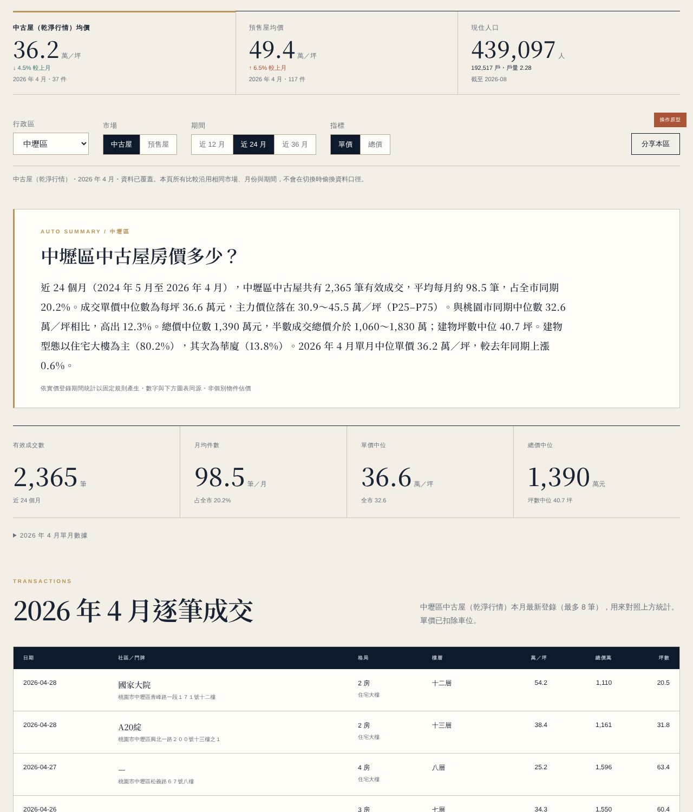 行政區頁：KPI 卡＋篩選 | 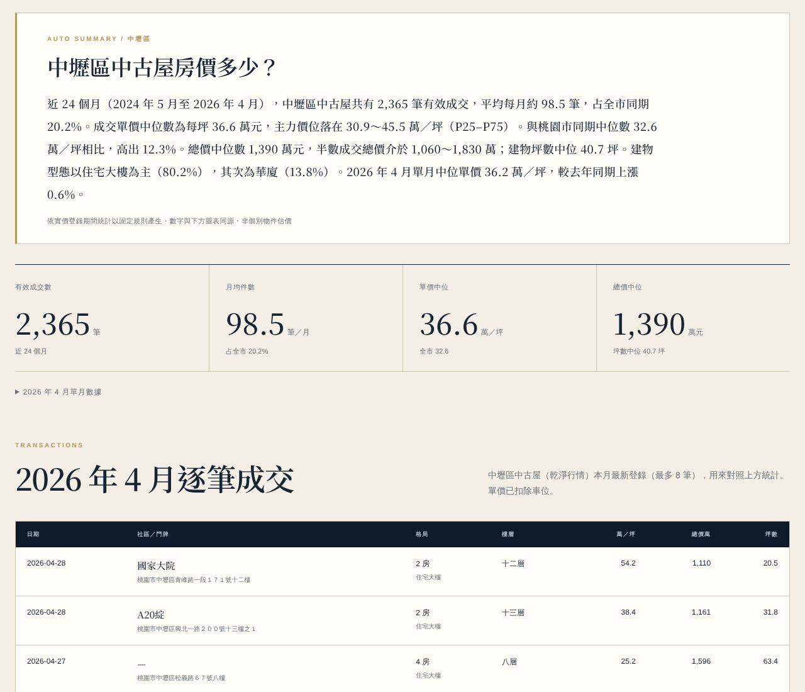 自動摘要＋四格統計 |
| 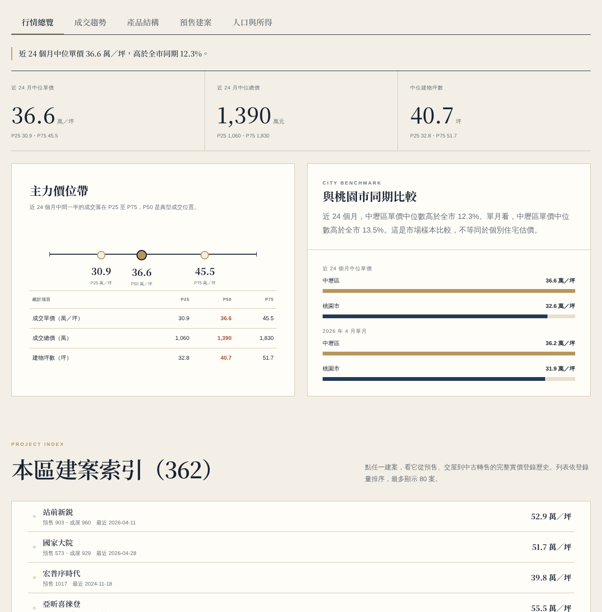 行情總覽 | 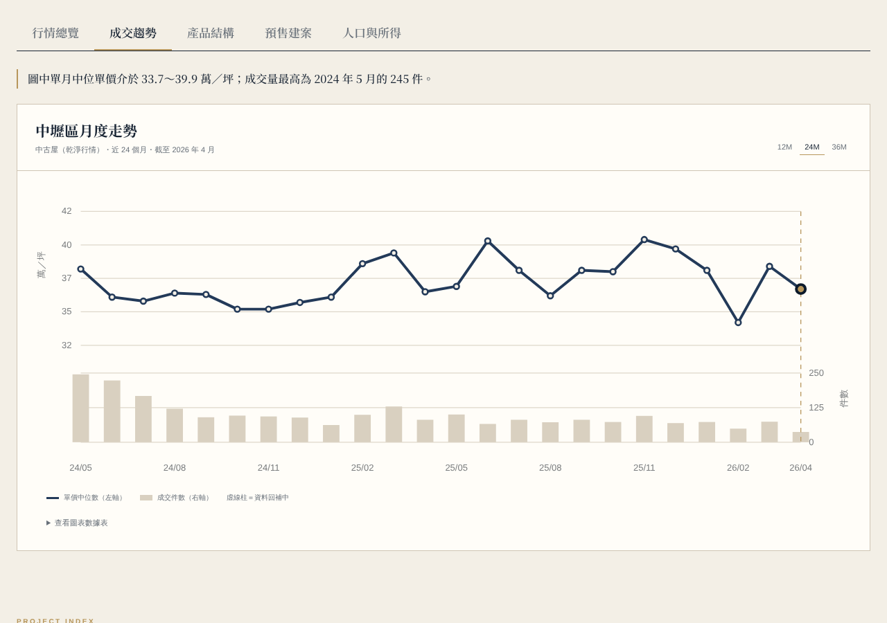 成交趨勢 |
| 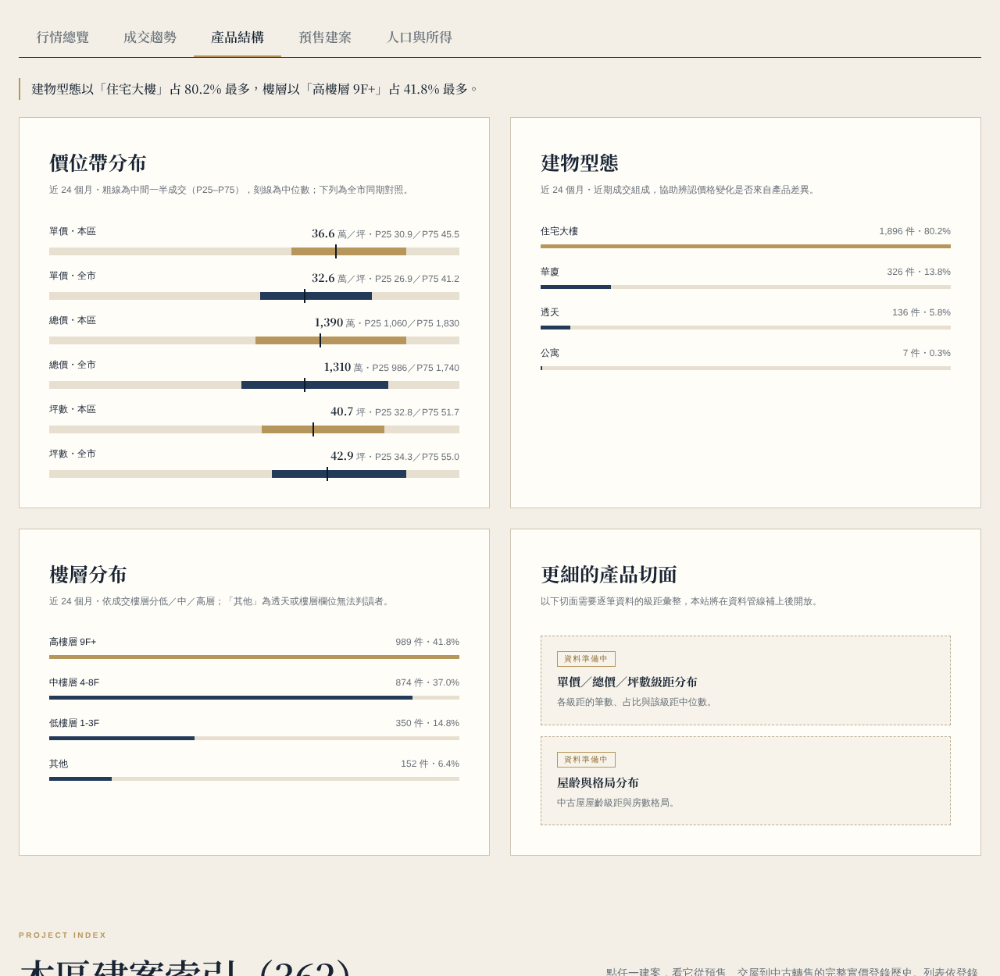 產品結構 | 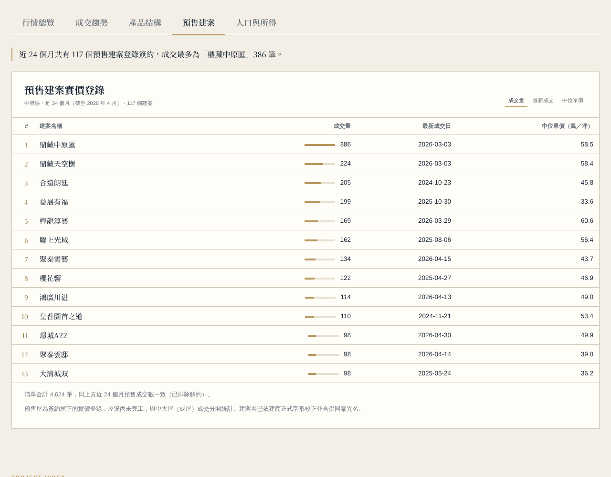 預售建案 |
| 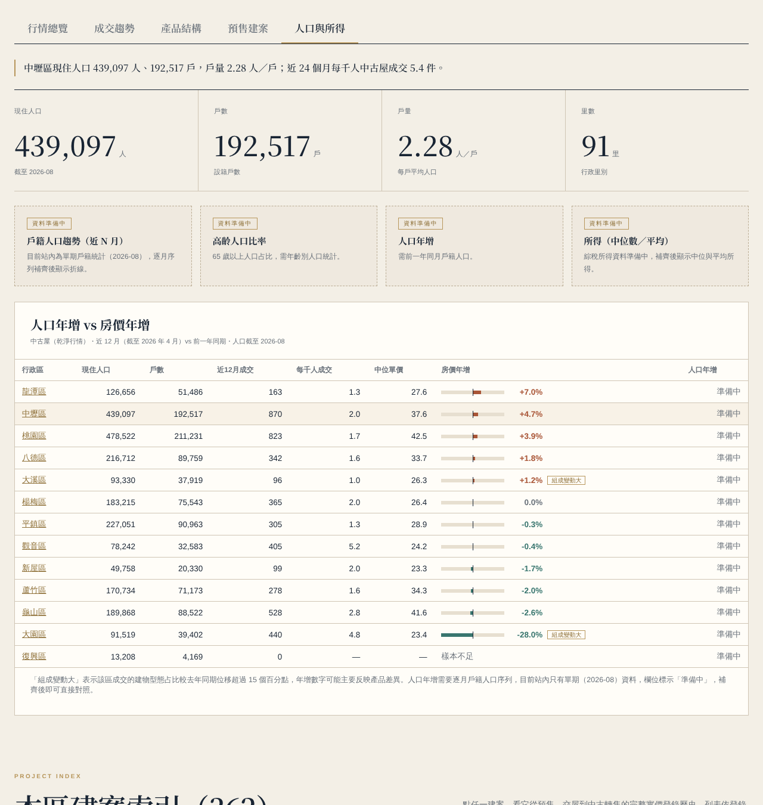 人口與所得＋交叉表 | 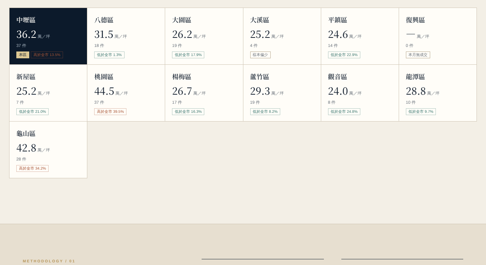 13 區磁磚牆 |
| 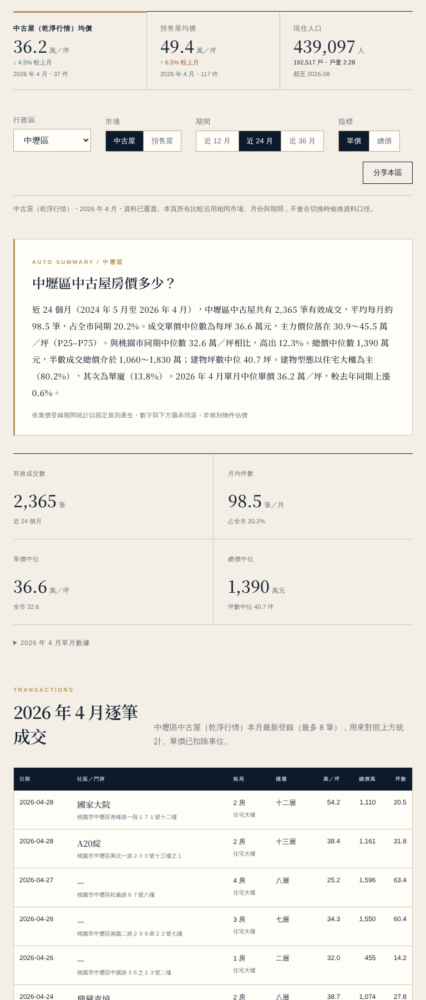 平板 768 | 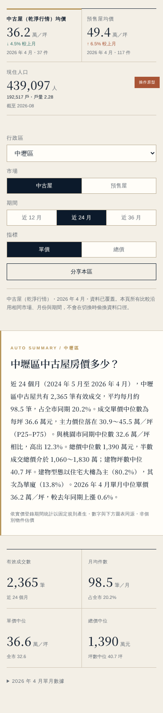 手機 390 |
| 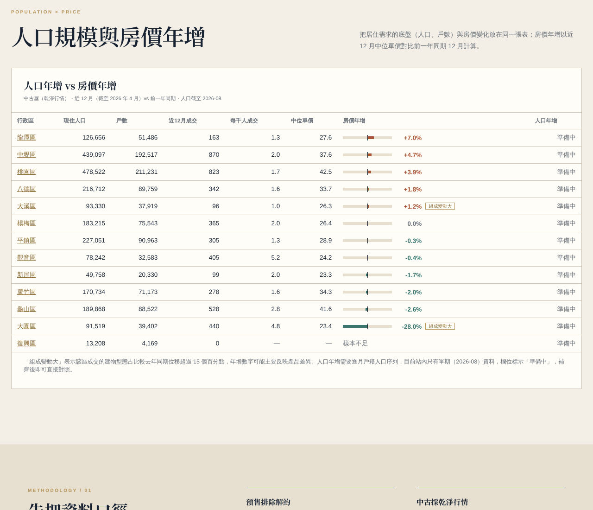 全市：人口×房價 | |

## 本機預覽

```bash
python3 -m http.server 8000
```

開 `http://localhost:8000/` 或 `http://localhost:8000/district/zhongli/`。

---

## 未竟事項／需要本機資料

1. **人口序列、高齡率、人口年增、所得**：需要本機補逐月戶籍人口（含年齡別）與綜稅所得。建議輸出成 `population.json` 的 `history`／`age65_ratio`／`income` 欄位，前端預留的「資料準備中」卡片就能換成真數字。
2. **級距分布（單價／總價／坪數各級距的筆數、占比、級距中位數）、中古屋齡與格局分布**：snapshots 只有 P25/50/75 與 type_mix／floor_mix，需要 ETL 在 snapshot 加 `price_bins`／`total_bins`／`ping_bins`／`age_mix`／`room_mix`。
3. **2026-05～07 動態回補簽約歸戶到建案**：歸戶後預售清單合計就會等於期間成交數。
4. **41 個亂碼建案名**：需要人工查建商官網或使用照，補進 `project_aliases.json`；`帝?德裝 德尊區` 很可能就是 `帝寶德莊 德尊區`（裝／莊字形差異），但規則不自動合併。
5. **Google Rich Results 線上測試**：雲端網路被擋，請上線後手動跑一次。
6. **WP5、WP6**：依任務書由本機處理；WP6 排程完成 ETL 後請接 `node tools/build-all.mjs`。
7. 其他觀察（未改動）：頁面右下角仍有「操作原型」標籤、footer 寫 OPERATION PROTOTYPE，正式上線前可考慮拿掉。`market.json` 的 resale_complete（2026-03）和前端實際使用的 `beido-market-data.json`（2026-04）不一致，前端只讀後者。

## 注意

`.gitignore` 預設忽略 `*.md`，本報告是用 `git add -f` 加入的。已在 `_config.yml` 排除，合併後不會被 Pages 公開；如果不想留在 repo，合併前刪掉即可。
